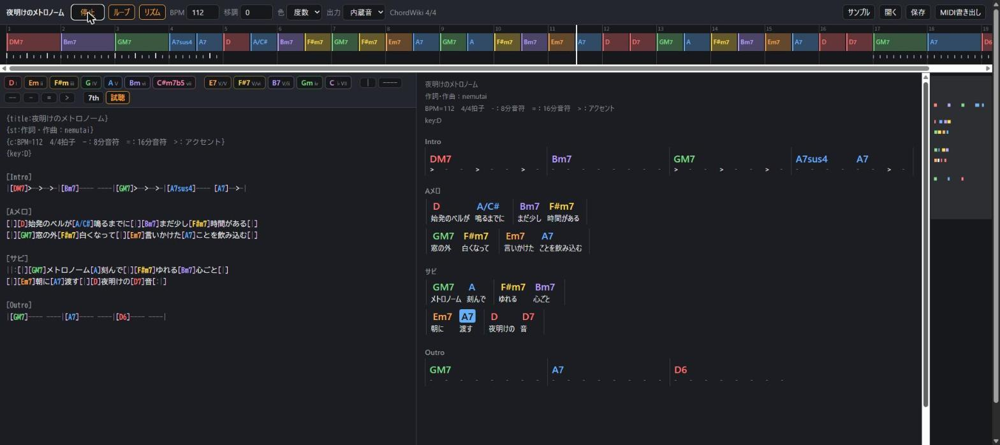

# nemutai Chord Editor

https://chord.nemut.ai/



An editor for chord sheets in ChordWiki format that plays them along a timeline as you write. It also reads rechord notation.

The whole app is two files, `public/index.html` and `public/engine.js`, with no build step and no dependencies. Your text is saved in your browser only and is never sent anywhere.

## Features

- Type on the left; the preview on the right and the timeline at the top update immediately
- The preview colours each chord by its scale degree in the key and shows lyrics and note lengths under the chords
- The timeline draws each chord as a block as long as it sounds; bars whose written lengths don't fill the meter (or overflow it) are marked in red with their length in beats
- Plays through a small built-in synth or a Web MIDI output, lighting up the current chord and the current note
- Exports a `.mid` file that drops straight onto a DAW timeline
- Open, save or drag in `.txt` files

### Writing help

| Action | What it does |
|---|---|
| Palette | Chords of the key (I–vii) plus V/V, V/vi, V/ii, iv and ♭VII. Click to insert and hear it (Shift+click only plays it) |
| `[` | Closes the bracket and suggests the key's chords and the chords already in the song. ↑↓ to choose, Enter or Tab to insert |
| Alt+1–7 | Inserts the chord on that degree (Alt+Shift for the seventh) |
| Caret onto a chord | Plays that chord (toggle with 試聴) |
| コード入力 (chord input) | While on, typing A–G outside brackets opens `[ ]` with suggestions, and a space, `\|` or length symbol steps out again: `C Am7 F` becomes `[C] [Am7] [F]` |
| Tab / Shift+Tab | Next / previous chord |
| Ctrl+] / Ctrl+[ | Next / previous chord, and play it |
| Ctrl+Shift+] / [ (or D / A) | Same |
| Ctrl+Shift+Space | Play the chord at the caret |
| Ctrl+/ | Comment the selected lines on / off |
| Ctrl+S / Ctrl+O | Save / open |
| Ctrl+Space | Plays from the chord at the caret, or stops |
| Space | Play / stop (outside the editor) |

In chord input mode (keys follow chordlistener's ChordWiki editor):

| Key | Outside a chord | Inside a chord |
|---|---|---|
| A–G (either case) | opens `[ ]` | bass note after `/` or `on` |
| 1–7 | the key's chord on that degree (7th toggle applies) | digits stay digits |
| N | `[N.C.]` | steps out and adds `[N.C.]` (an `n` right after `o` stays, for `on`) |
| `\|` `\` `/` `¥` | `\|` on lines of chords and lengths only (intros, interludes), `[\|]` once the line has lyrics | `/` stays (slash chord) |
| `^` `` ` `` | `=` | |
| `:` `'` | `----` | |
| `;` `@` | `>` | |
| W F X V | | `#` `b` `##` `bb` |
| R J K H | | `m7` `M7` `m7-5` `dim` |
| Y L Z Q P | | `add` `aug` `sus` `omit` `+` |
| `[` | | `()` |
| space, `\|`, lengths | | step out of the chord first |

Backspace just after a chord's `]` (or Delete just before its `[`) removes the whole `[Am]`; inside the brackets, keys edit one character at a time, and an empty `[]` or `()` goes with its last character.

### Web MIDI on Windows 11

With Windows MIDI Services (Windows 11 25H2 and later) Chrome's default MIDI backend can deadlock while sending if any MIDI input receives data at the same time, and the whole browser stops responding. Turn on `chrome://flags/#use-winrt-midi-api` (Use Windows Runtime MIDI API) before choosing a MIDI output.

## ChordWiki format

```
{title:Song}
{c:BPM=96　4/4拍子　-：8分音符　=：16分音符　>：アクセント}
{key:C}

[Intro]
|[CM7]---- ----|[Am7]---- ----|[Dm7]---- [G7]-->-|[C]---- ----|

[Verse]
[|][C]lyrics go[Em7]here and[|][F]show under[G7]the chords[|]
```

| Syntax | Meaning |
|---|---|
| `[C]lyrics` | A chord; the lyrics after it are shown under it |
| `\|` `[\|]` | Barline |
| `-` `=` `>` … | Note lengths. Their meaning is read from the song's legend in `{c:}` (`symbol：N分音符` = 1/N note, `symbol：N分音符アクセント` = accented 1/N note, `symbol：アクセント` = accent). Without a legend: `-` eighth, `=` sixteenth, `>` accent |
| `16分音符(shuffle)` | In the legend: swing sixteenths (or eighths for `8分音符`) 2:1 |
| `N/M拍子` `BPM=` | In the legend: time signature and tempo |
| `/` | One beat |
| `\|\|: … :\|\|` | Play the section twice |
| `[Intro]` `[Aメロ]` | A bracket alone on its line that is not a chord name is a section label |
| `[N.C.]` | No chord |
| Line without barlines | Each chord gets one bar |
| Bar without lengths | Chords are placed as rechord does (2 chords on beats 1 and 3, 3–4 in quarters, 5–8 in eighths, …) |

Every written note is played again, and accents are louder (turn off リズム to play chord changes only). An accent written right next to plain notes takes their length; on its own it has its legend length.

## rechord format

The notation of [rechord](https://github.com/comorebi-notes/rechord): `|` separates bars, `%` repeats the chord, `_` is a rest, `=` holds, `/` or `on` gives the bass note, and a line starting with `#` is a memo.

Chords are voiced as rechord does: the root sits in octave 3 (C3 = 48), notes are added or removed from a 13th chord according to the chord name, chords with fewer than five notes double their lower notes an octave up, and an on-chord bass goes below the chord.

## Development

```
npm run serve     # http://localhost:8000/ (engine.js is an ES module, so file:// won't work)
npm test          # plays every score in test/fixtures and compares it with test/expected
npm run deploy    # uploads to Cloudflare (wrangler)
```

The files in `test/expected` were saved after checking that the output matches both the REAPER JSFX version of this player and rechord itself. After an intended change in behaviour, regenerate them with `node test/run.mjs --update`.

## License

MIT ([LICENSE](LICENSE)). Notices for the part derived from chord-translator (MIT) and for rechord are in [public/THIRD_PARTY.md](public/THIRD_PARTY.md).
